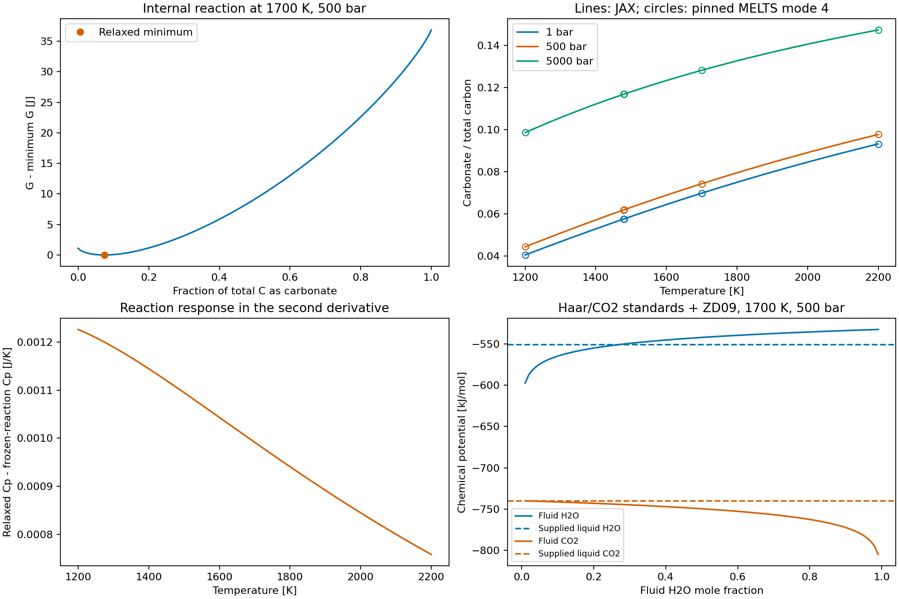
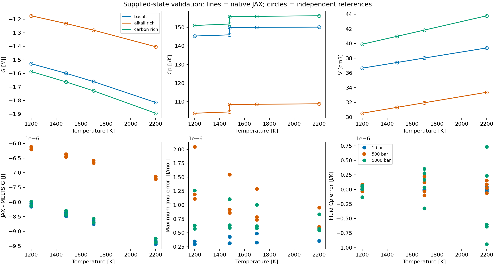

Native JAX carbonate liquid and mixed fluid
============================================

``exoeos.magma_carbonate`` supplies a separate rhyolite-MELTS 1.2.0
**mode-4** liquid model. It appends independent CO2 to the twelve-component
hydrous basis and equilibrates one internal carbonate reaction. Its water
standard and water/host interactions differ from mode 1 even at zero carbon.
Select this module explicitly; ``exoeos.magma.liquid_gibbs`` retains its
mode-1 behavior.

``exoeos.magma_fluid.mixed_fluid_gibbs`` supplies H2O--CO2 fluid G using
the native gas reference convention and an explicitly chosen existing EOS.
The example selects Zhang--Duan (2009), including its published binary
parameters. This is a hybrid property model, not the MELTS Duan--Zhang
(2006) mixed-fluid EOS. Both providers evaluate supplied states.
Saturation, fluid amounts, phase selection, redox and carbonate solids are
separate extensions/consumer responsibilities. S/N chemistry remains a
separate extension. No empirical solubility offset is added.

Inputs, independent amounts and species
----------------------------------------

.. list-table:: Public contracts
   :header-rows: 1
   :widths: 40 60

   * - Entry
     - Meaning
   * - ``magma_carbonate.COMPONENTS``
     - ``magma.HYDROUS_COMPONENTS + ("CO2",)``: SiO2, Mg2SiO4, Fe2SiO4,
       CaSiO3, Al2O3, Fe2O3, TiO2, MgCr2O4, Na2SiO3, KAlSiO4,
       Ca3(PO4)2, H2O, CO2. Thirteen **absolute mol amounts**.
   * - ``magma_carbonate.liquid_gibbs(T, P, n)``
     - Extensive relaxed liquid G, J; scalar K/Pa, shape-(13,) mol.
   * - ``liquid_standard_gibbs(T, P)``
     - Thirteen independent-component standards, J/mol.
   * - ``liquid_species_moles(T, P, n)``
     - Fourteen species amounts in ``SPECIES = COMPONENTS + ("CaCO3",)``
       order. CaCO3 is internal, not another conserved input amount.
   * - ``liquid_moles_from_oxides`` / ``oxide_moles_from_liquid``
     - ``OXIDES = magma.HYDROUS_OXIDES + ("CO2",)``. The host conversion
       is reused; H2O/CO2 pass through. Signed residuals are retained,
       so the caller must validate nonnegative host coordinates.
   * - ``magma_fluid.mixed_fluid_gibbs(T, P, n, eos=...)``
     - Extensive fluid G, J; shape-(2,) mol in ``FLUID_COMPONENTS =
       ("H2O", "CO2")`` order. Supply a matching binary EOS explicitly.

``magma.ELEMENTS`` now ends with ``("H", "C")``. The shared
``element_matrix`` has thirteen rows; older phase columns gain a zero C
row. CO2 contributes C + 2O; CaCO3 contributes Ca + C + 3O. Consumers
must use ``len(ELEMENTS)``. Existing phase amount bases and energies are
unchanged by this metadata extension.

.. code-block:: python

   import jax
   jax.config.update("jax_enable_x64", True)
   import jax.numpy as jnp
   from functools import partial
   from exoeos import ZhangDuanEOS, magma_carbonate as liquid
   from exoeos.magma import element_matrix
   from exoeos.magma_fluid import FLUID_COMPONENTS, mixed_fluid_gibbs

   n = jnp.array([.5, .15, .05, .15, .1, .01, .01,
                  .002, .02, .01, .002, .05, .001])
   T, P = 1700., 5e7
   G = jax.jit(liquid.liquid_gibbs)(T, P, n)
   species = liquid.liquid_species_moles(T, P, n)
   mu = jax.grad(liquid.liquid_gibbs, 2)(T, P, n)
   Cp = -T * jax.grad(jax.grad(liquid.liquid_gibbs, 0), 0)(T, P, n)
   atoms = element_matrix(liquid.COMPONENTS) @ n
   fluid = partial(mixed_fluid_gibbs,
                   eos=ZhangDuanEOS.from_species(FLUID_COMPONENTS))
   mu_fluid = jax.grad(fluid, 2)(T, P, jnp.array([.03, .02]))
   transfer_slope = mu_fluid - mu[-2:]  # H2O, CO2: liquid -> fluid

One scalar G and the internal reaction
---------------------------------------

The liquid reaction is

.. math::

   \mathrm{CaSiO_3+CO_2\rightleftharpoons SiO_2+CaCO_3}.

Let :math:`N=\sum_i n_i` and let :math:`\xi` be mol of reaction progress.
Species amounts are :math:`m=(n,0)+\nu\xi`, with :math:`\nu` equal to +1
for SiO2/CaCO3 and -1 for CaSiO3/CO2. Thus :math:`\sum_a m_a=N` and
:math:`A_{\rm species}m=A_{\rm components}n`. With :math:`y=m/N` and
:math:`x_w=n_{\rm H_2O}/N`, the unrelaxed energy is

.. math::

   \widehat G=\sum_i n_i g_i^0+\xi\Delta g_r^0
     +RTN\sum_a y_a\ln y_a+\frac{N}{2}y^{\mathsf T}Wy
     +RTN[x_w\ln x_w+(1-x_w)\ln(1-x_w)],

.. math::

   G=\min_{0\le\xi\le\min(n_{\rm CaSiO_3},n_{\rm CO_2})}\widehat G,
   \qquad
   \Delta g_r^0=-17574.497522747-1.9034060173857(p-1),\quad p=P/10^5.

Here :math:`R=8.3143` J/(mol K), :math:`p` is bar, and W is symmetric
with a zero diagonal. Its 91 species pairs comprise 55 unchanged dry
interactions and 36 water/carbon interactions from the mode-4 header.
All pair entropy/volume coefficients vanish. Water's extra binary entropy
is additional to the ordinary species ideal entropy; CO2 has no extra term.

For positive Ca and C the stationary point satisfies

.. math::

   0=\widehat G_\xi=\Delta g_r^0+\nu^{\mathsf T}Wy
       +RT\ln\frac{y_{\rm SiO_2}y_{\rm CaCO_3}}
                       {y_{\rm CaSiO_3}y_{\rm CO_2}}.

Its reaction curvature is strictly positive:

.. math::

   \widehat G_{\xi\xi}
    =\frac{113246.6}{N}
       +RT\left(\frac1{m_{\rm SiO_2}}+\frac1{m_{\rm CaCO_3}}
                +\frac1{m_{\rm CaSiO_3}}+\frac1{m_{\rm CO_2}}\right)>0.

There is one reaction minimum on each positive-Ca/C face. This does not
establish convexity in independent compositions or stability against other
phases. Eighty bisection steps solve stationarity; ``jax.lax.custom_root``
differentiates the equation implicitly. Unrepresentable roots return NaN
instead of imposing a species floor. For :math:`q=(T,P,n)`,

.. math::

   G_q=\widehat G_q,\qquad
   G_{qq}=\widehat G_{qq}
       -\widehat G_{q\xi}\widehat G_{\xi\xi}^{-1}\widehat G_{\xi q}.

The second term is essential for Cp, compressibility, composition Hessians
and mixed T/P/composition derivatives. Relaxation increases Cp by
:math:`T\widehat G_{T\xi}^2/\widehat G_{\xi\xi}`. Tests compare the AD
Hessian with this Schur correction and finite differences. Freezing the
optimized reaction extent would omit this response.

   A fixed basalt-like composition demonstrates the reaction response.
   Circles are pinned mode-4 MELTS references. Fluid curves vary fluid
   composition at fixed T/P; dashed lines retain the supplied liquid
   composition. These are not an equilibrium path.

Standards and the binary fluid
-------------------------------

The eleven dry standards are reused. Mode-4 dissolved water uses the
Haar real 1-bar reference and Robie subtraction from
:doc:`native_hydrous_liquid`, replacing its pressure polynomial:

.. math::

   g_w^0={}&g_{\rm Haar}(T,1\,{\rm bar})+R(-33676+18.3527T)-g_{\rm Robie}(T)
      +2783.6851512128-2.3838467967178T\\
      &+[2.775+1.086\,10^{-3}(T-1673.15)](p-1)
      -\tfrac12(0.382\,10^{-4})(p-1)^2.

The dissolved CO2 standard is

.. math::

   g_c^0={}&g_{\rm DZ06,CO_2}(T,1\,{\rm bar})-630.93193811701+109.39331414050T\\
      &+[4.0157994267547+1.213189\,10^{-3}(T-1673.0)](p-1)
      -\tfrac12(0.4267387\,10^{-4})(p-1)^2.

The distinct reference temperatures, 1673.15 and 1673.0 K, follow the source.
The internal standard is
:math:`g^0_{\rm CaCO_3}=g^0_{\rm CaSiO_3}+g^0_c-g^0_{\rm SiO_2}+\Delta g_r^0`.
The private CO2 routine implements only the pure-fluid 1-bar root needed
by this standard; it is not a new public EOS.

For the mixed fluid, :math:`N_f=\sum_i n_i^f`, :math:`z_i=n_i^f/N_f` and
:math:`R_f=8.31446261815324` J/(mol K):

.. math::

   G_f=\sum_i n_i^f g_{i,\rm gas}^0(T)
      +R_fT\left[\sum_i n_i^f\ln z_i
        +N_f\left(\ln\frac{P}{10^5}+g_{\rm EOS}^r/(R_fT)\right)\right],

.. math::

   \mu_i^f=g_{i,\rm gas}^0+R_fT[\ln z_i+\ln(P/10^5)+\ln\phi_i].

H2O's gas standard is the analytic dilute Haar limit from
:doc:`native_magma_fluid`; CO2 uses ``idealGasCO2`` from pinned
``fluidPhase.c``, integrating its 13-term Cp polynomial with the original
8.31451 constant and H/S offsets. Liquid CO2 uses the **real** DZ06 1-bar
reference; fluid CO2 uses its **ideal** standard. Keeping the 1-bar residual
separate avoids double counting with the selected EOS. Reference alignment
does not establish experimental accuracy of liquid/fluid saturation.

ZD09 combines :math:`\epsilon_{ij}=k^\epsilon_{ij}\sqrt{\epsilon_i\epsilon_j}`
and :math:`\sigma_{ij}=k^\sigma_{ij}(\sigma_i+\sigma_j)/2`; H2O/CO2 binary
factors are 0.85 and 1.02. Its existing stable low-density root is
differentiated implicitly. Liquid-to-fluid transfer obeys
:math:`dG_{\rm total}/d\eta_i=\mu_i^f-\mu_i^l`, conserving both H and C.

Boundaries and derivative domains
----------------------------------

Enable JAX x64 and validate finite positive scalar T/P and nonnegative
amounts before transformations. Haar requires T >= 700 K; compiled
standards are checked through 2500 K. Liquid comparisons cover
1200--2200 K, 1--5000 bar; fluid controls use 1200, 1700, 2200 K at
1, 500, 5000 bar. These verification ranges are not new experimental
calibration bounds. The fluid EOS also imposes its own physical/root domain.

* Absent phases have exactly G=0. Their guarded zero AD values are not
  insertion potentials. Evaluate candidates at positive amount and a
  specified composition.
* Species/component zeros use continuous energy limits without floors.
  Pure endpoints and fixed composition faces support G and T/P derivatives.
  Full composition derivatives require positive independent interiors;
  absent ideal-component potentials have divergent limits.
* Zero Ca or zero C closes the internal reaction. Equimolar Ca/C only
  changes the numerical bracket expression, not the physical branch.
  This model has no competing internal reaction minima at positive T.
* SiO2 retains its Cp branch at 1480 K. Compare derivatives within each
  branch; do not finite-difference across it.
* Fluid root changes or loss of mechanical stability retain the EOS's
  derivative restrictions. Derivatives through phase selection are outside
  this provider.

Independent verification and reproduction
------------------------------------------

The source fixture hashes six files at MAGMA revision
``705a0fb315e5054d18275a580562f6121c8e458c``. It directly compiles upstream
pure-fluid routines and extracted mode-4 branches, checks 63 standards,
and parses all 91 pairs. A separate NumPy/SciPy calculation integrates
ZD09 compressibility and solves pressure for 45 mixed-fluid/endpoint states.
It never imports JAX or ExoEOS.

The runtime fixture uses hash-pinned alphaMELTS 2.3.2 mode 4 with oxygen
buffering disabled. Its 53 supplied liquids include three hosts, four random
interiors, sevenfold scaling, dry/zero-C and trace-C controls. Returned oxide
inventories, independent fractions and Euler identities are checked. The
release binary's thermodynamic C build commit is not independently
established; source and binary comparisons remain separate evidence.

.. list-table:: Maximum absolute errors for supplied extensive amounts
   :header-rows: 1

   * - Quantity
     - Liquid vs pinned mode 4
     - Fluid vs independent ZD09
   * - G (J)
     - 6.12e-5
     - 8.15e-10
   * - S (J/K)
     - 9.03e-9
     - 5.91e-11
   * - Cp (J/K)
     - 4.49e-9
     - 9.42e-7
   * - V (m3)
     - 1.44e-14
     - 6.11e-16
   * - dV/dT (m3/K)
     - 1.02e-18
     - 3.77e-16
   * - dV/dP (m3/Pa)
     - 1.78e-24
     - 3.72e-18

The 50 regular-interior liquid potential comparisons have maximum error
6.49e-6 J/mol. The :download:`complete comparison
<_static/magma/carbonate_comparison.json>` also records species errors.
**Trace-carbon caveat:** at 1e-9 mol CO2 the pinned runtime leaves CaCO3 at
zero; JAX finds a positive stationary amount. The CO2 potential differs by
about 1089 J/mol. This point is reported separately from regular-interior
potential agreement; the raw reference is preserved. Native trace
stationarity and the :math:`RT\ln n_c` dilute slope are tested independently.
For the exact-zero-Ca sample, runtime oxide conversion produces negative
roundoff CaSiO3 and aborts. The failure is saved; native fixed-face limits
are tested without perturbing the input.

   Upper panels use 500 bar; lower liquid residuals include all three
   pressures for the named hosts. Fluid Cp errors include numerical
   differentiation of the independent pressure integral.

Tests also cover Hessian symmetry/mixed derivatives, the explicit relaxation
correction, Euler homogeneity, atom-conserving transforms, zero phases,
endpoints, the 1480 K branch, JIT/vmap and H2O/CO2 transfer. Kernels and
coefficients are installed in ``exoeos``; examples and MELTS are not runtime
dependencies.

.. code-block:: bash

   python tests/reference/generate_carbonate_reference.py \
     --source /path/to/pinned/source-files --output /tmp/carbonate_source.json
   python tests/reference/generate_carbonate_reference.py \
     --runtime /path/to/pinned/alphamelts --python /path/to/reference/python \
     --output /tmp/carbonate_melts.json
   python examples/magma_carbonate.py --output documents/_static/magma
   python -m pytest tests/unittests/magma_carbonate_test.py \
     tests/unittests/magma_mixed_fluid_test.py

Sources: `liquid_CO2_H2O.c
<https://github.com/magmasource/MAGMA/blob/705a0fb315e5054d18275a580562f6121c8e458c/sources/liquid_CO2_H2O.c>`_,
`param_struct_data_CO2_H2O.h
<https://github.com/magmasource/MAGMA/blob/705a0fb315e5054d18275a580562f6121c8e458c/includes/param_struct_data_CO2_H2O.h>`_,
`gibbs.c
<https://github.com/magmasource/MAGMA/blob/705a0fb315e5054d18275a580562f6121c8e458c/sources/gibbs.c>`_,
`fluidPhase.c
<https://github.com/magmasource/MAGMA/blob/705a0fb315e5054d18275a580562f6121c8e458c/sources/fluidPhase.c>`_,
and `Zhang and Duan (2009) <https://doi.org/10.1016/j.gca.2009.01.021>`_.

.. automodule:: exoeos.magma_carbonate
   :members: liquid_gibbs, liquid_standard_gibbs, liquid_species_moles, liquid_moles_from_oxides, oxide_moles_from_liquid

.. autofunction:: exoeos.magma_fluid.co2_gas_standard_gibbs

.. autofunction:: exoeos.magma_fluid.mixed_fluid_gibbs
