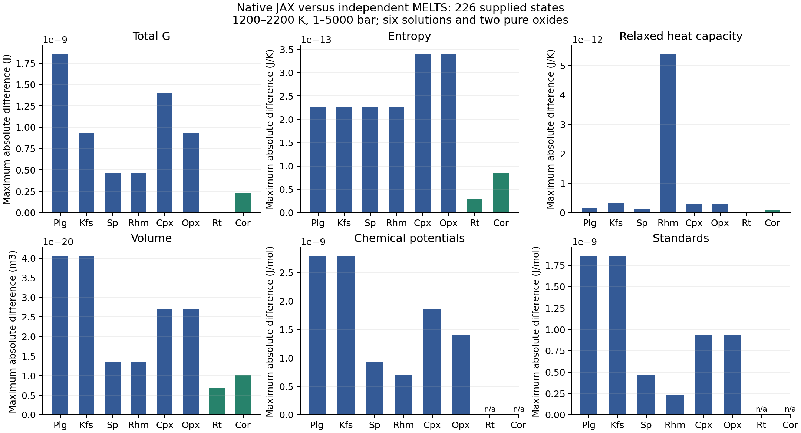
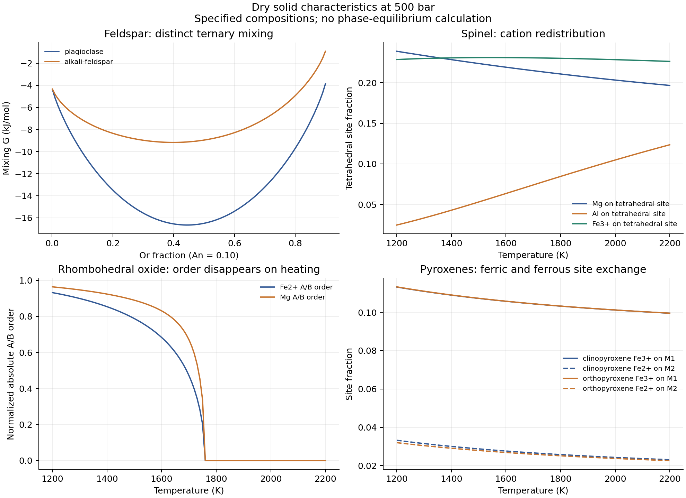

Native JAX dry solid solutions
==============================

``exoeos.magma_solids`` extends the native magma property model with Na/Ca/K
feldspars, spinel, Mn-free rhombohedral oxides, rutile, corundum, and
Al/Na/Ti/Fe(III)-bearing clino- and orthopyroxenes. Each family lives in a
small module. A shared helper evaluates the source polynomials and relaxes
internal site order. Evaluation and automatic differentiation require only
the normal ExoEOS dependencies, with JAX x64 enabled.

These are supplied-phase Gibbs functions. Phase amounts, coexistence,
redox equilibrium and selection of competing phases remain the caller's
responsibility. The earlier cooling examples retain their declared phase
sets. This extension does not add garnet, hydrous minerals, or Mn-bearing
oxide solutions.

Dry solid coverage after this extension
---------------------------------------

.. list-table:: Features and references of the implemented dry solids
   :header-rows: 1
   :widths: 16 27 39 18

   * - Phase / module
     - Amount basis, in mol
     - Mixing and internal order
     - References
   * - Olivine (existing ``magma``)
     - Mg2SiO4, Fe2SiO4
     - Binary Fo--Fa; two-site ideal entropy and pressure-dependent regular interaction
     - Berman (1988); pinned ``olivine.c``
   * - Silica (existing ``magma``)
     - SiO2
     - Quartz, tridymite, cristobalite; pure standards, transition branches
     - Berman (1988); pinned ``gibbs.c`` and documented runtime offsets
   * - Plagioclase (``feldspar``)
     - NaAlSi3O8, CaAl2Si2O8, KAlSi3O8
     - Distinct ternary polynomial; two albite order variables in the standard;
       sanidine disorder and phase-specific Or reference
     - Elkins & Grove (1990) framework; pinned ``gmixPlg`` instruction audit
   * - Alkali feldspar (``feldspar``)
     - Same Ab--An--Or order
     - Asymmetric ternary mixing; same pure disorder treatment;
       separate An standard
     - Elkins & Grove (1990); pinned ``feldspar.c``
   * - Spinel (``spinel``)
     - FeCr2O4, FeAl2O4, Fe3O4, MgAl2O4, Fe2TiO4
     - Five formal endmembers; three coupled tetrahedral/octahedral orders;
       relaxed pure references and magnetite lambda anomaly
     - Sack & Ghiorso (1991a,b); pinned ``spinel.c``
   * - Rhombohedral oxide (``oxides``)
     - MgTiO3, Fe2O3, FeTiO3, Al2O3
     - Mn-free Ghiorso--Evans model; two Fe/Mg--Ti orders; fixed SRO=0.0730205;
       hematite anomaly; pure-reference ordering also relaxed
     - Ghiorso & Evans (2008); pinned ``rhomsghiorso.c``
   * - Clino- and orthopyroxene (``pyroxene``)
     - Di, cEn, Hd, Al-buffonite, buffonite, essenite, jadeite
     - Two coupled orders: Fe(II)/Mg between M1/M2, Al/Fe(III) between
       M1/tetrahedral sites; signed formal endmembers; monoclinic references
     - Sack & Ghiorso (1994a,b,c); pinned ``clinopyroxene.c``, ``orthopyroxene.c``
   * - Rutile and corundum (``oxides``)
     - TiO2 and Al2O3, respectively
     - Pure Berman standards, no mixing; separate corundum is 20 kJ/mol
       below the rhombohedral solution's Al2O3 standard
     - Berman (1988); pinned ``sol_struct_data.h`` and rutile runtime offset

The older Di--Hd and Ca--Mg--Fe pyroxene APIs remain available. Their exact
composition restrictions are recovered by the new seven-component model.
Magnetite and hematite are endpoints of the spinel and rhombohedral models,
respectively. Iron valence is encoded by the formulas and site model; the
conserved element ledger has one Fe row, together with an O row.

Public API and amount bases
---------------------------

All four modules expose ``COMPONENTS``, ``standard_gibbs(T, P)``,
``mixing_gibbs(T, P, n)`` and ``gibbs(T, P, n)``. Temperature and pressure
are scalar **K and Pa**. Standards return J/mol, whereas mixing and total
G return **J for the supplied absolute mol amounts**. The total is the sum
of the standard contribution and the extensive mixing contribution.
``feldspar`` additionally accepts the static keyword
``phase="plagioclase"`` (default) or ``"alkali-feldspar"`` in all three
G functions. ``pyroxene`` accepts ``phase="clinopyroxene"`` (default) or
``"orthopyroxene"`` for mixing, total G and order; its standards are shared.

.. code-block:: python

   import jax
   import jax.numpy as jnp
   from exoeos.magma import element_matrix
   from exoeos.magma_solids import spinel

   jax.config.update("jax_enable_x64", True)
   n = jnp.array([0.1, 0.2, 0.2, 0.3, 0.2])  # mol, not oxide masses
   T, P = 1600.0, 5.0e7
   G = jax.jit(spinel.gibbs)(T, P, n)
   mu = jax.jit(jax.grad(spinel.gibbs, 2))(T, P, n)
   Cp = -T * jax.jit(jax.grad(jax.grad(spinel.gibbs, 0), 0))(T, P, n)
   atoms = element_matrix(spinel.COMPONENTS) @ n

``order(T, P, n)`` returns dimensionless site coordinates for a **present**
spinel, rhombohedral oxide, or pyroxene. Its docstring gives the coordinate
order. ``feldspar.albite_order(T, P)`` exposes the two standard-state order
parameters. ``oxides.rutile_gibbs`` and ``oxides.corundum_gibbs`` return J/mol;
multiply by phase amount for an extensive pure-phase contribution.

The pyroxene formula basis is

.. math::

   \boldsymbol n=[\mathrm{CaMgSi_2O_6},\mathrm{Mg_2Si_2O_6},
   \mathrm{CaFeSi_2O_6},\mathrm{CaTi_{0.5}Mg_{0.5}AlSiO_6},
   \mathrm{CaTi_{0.5}Mg_{0.5}FeSiO_6},\mathrm{CaFeAlSiO_6},
   \mathrm{NaAlSi_2O_6}].

There are six O atoms per formula, and the two buffonites contain half an
Mg and half a Ti atom. ``element_matrix`` therefore returns exact
half-integer columns for this basis; old integer-only bases retain integer
arrays. The new formula amount is :math:`N=\sum_i n_i`. The existing
``magma.pyroxene_gibbs`` instead takes one-Si inventory coordinates and uses
:math:`N=\sum_i n_i/2`. These APIs must not share an unconverted amount vector.

Standard G, mixing, and internal order
--------------------------------------

With :math:`x_i=n_i/N` and :math:`p=P/10^5` in bar, the construction is

.. math::

   G(T,P,\boldsymbol n)=\sum_i n_i g_i^0(T,P)+N\left[
   \min_{\boldsymbol q\in D(\boldsymbol x)}\phi(T,P,\boldsymbol x,\boldsymbol q)
   -\sum_i x_i\phi_i^{\mathrm{ref}}(T,P)\right],

.. math::

   \phi=H_{\mathrm{poly}}-T S_{\mathrm{poly}}
     +(p-1)V_{\mathrm{poly}}+R_bT\sum_s m_s y_s\ln y_s,
   \qquad R_b=8.3143\ \mathrm{J\,mol^{-1}\,K^{-1}}.

The affine site fractions :math:`y_s` conserve the specified composition.
For spinel their multiplicities are one and two on tetrahedral and
octahedral sites. Pyroxene's coupled site-normalization terms and the
rhombohedral SRO correction include signed multiplicities from the source;
they must not be replaced with ideal endmember mixing. Zero sites use the
continuous :math:`0\ln0=0` energy limit. The source H/S/V coefficients are
reused from the audited transcription in ``examples/m2_solid_mixing`` and
extracted into package-local numeric constants. No external source file,
JSON parameter file, SymPy, or native MELTS library is loaded at evaluation.

For feldspars, the solution-order and pure-reference terms in this mixing
construction are absent. Their ideal entropy is :math:`R_bT\sum_i x_i\ln x_i`.
The alkali-feldspar excess polynomial has the asymmetric ternary form

.. math::

   g^{\mathrm{ex}}=\sum_{i<j}x_ix_j
     \left[W_{ij}(x_j+x_k/2)+W_{ji}(x_i+x_k/2)\right]
     +W_{123}x_1x_2x_3,
   \quad W=H_W-TS_W+(p-1)V_W,

where :math:`k` is the remaining component. The plagioclase H polynomial
differs and is preserved from the existing, hash-pinned ``gmixPlg`` binary
instruction transcription. It is not an alias of ``feldspar.c``.

The standard states integrate Berman heat capacity and volume from
:math:`T_r=298.15` K and :math:`p_r=1` bar:

.. math::

   C_p=k_0+k_1T^{-1/2}+k_2T^{-2}+k_3T^{-3},\qquad
   g^0=H_r+\int_{T_r}^{T}C_p\,dt
     -T\left[S_r+\int_{T_r}^{T}\frac{C_p}{t}\,dt\right]
     +\int_1^p V(T,p')\,dp'.

The native polynomial uses volume in J/bar/mol internally. The public
pressure derivative is in m3/mol, since its input is Pa. Magnetite and
hematite additionally integrate :math:`C_{p,\lambda}=T(l_1+l_2T)^2` up to
848 K and 955 K, respectively, with the source latent heat at the cutoff.
Albite adds the minimum of the coupled two-order-parameter Salje polynomial
from ``albite.c``. Sanidine adds the H/S integrals of the source disorder
heat capacity up to :math:`\min(T,1436\ \mathrm K)`, with its associated
volume correction. Anorthite retains the existing Carpenter correction.

.. list-table:: Reference conventions that affect total phase G
   :header-rows: 1
   :widths: 24 38 38

   * - Term
     - Implementation
     - Evidence / consequence
   * - Plagioclase Or
     - Add :math:`44905.5-15.012T` J/mol to the common K-feldspar standard
     - Phase-specific pinned-runtime H/S offset; verified across 11 T/P states
   * - Alkali-feldspar An
     - Add 19487 J/mol to the existing anorthite standard
     - Phase-specific pinned-runtime H offset, separate from mixing
   * - Common sanidine standard
     - Published ``RHYOLITE_ADJUSTMENTS`` H correction: +3400 J/mol
     - Applied before either phase-specific offset
   * - Rutile
     - Add -9318.13 J/mol to the published rutile H reference
     - Pinned-runtime H offset; S, Cp and V require no offset
   * - Rhombohedral Al2O3
     - Standard is pure corundum +20000 J/mol
     - Explicit source adjustment; pure ``corundum_gibbs`` omits it
   * - Both pyroxene structures
     - Subtract monoclinic pure-order references, including relaxed essenite
     - Opx is not obtained by replacing the cEn standard with a pure Opx standard
   * - Spinel / rhombohedral pure curves
     - Relax and subtract their own pure-order G at the same T/P
     - Their T/P derivatives contribute to S, Cp, V and mixed derivatives

The two phase-specific feldspar offsets and the rutile H offset are **runtime alignment constants**,
not claims about the contents of the public MAGMA header. Their difference
has a maximum residual below :math:`7\times10^{-10}` J/mol over the fixture.
The binary thermodynamic build's identity with the public C revision is not
established. All other transferred standards match the pinned native values
without additional fitted offsets.

Relaxed derivatives and domains
-------------------------------

The site solver uses feasible damped Newton steps. Inactive order coordinates
are removed through identity equations on the corresponding composition
face. Live sites remain strictly positive during the line search; structural
zeros stay on their fixed face. Diagonal scaling makes the convergence and
curvature checks meaningful for trace-species order coordinates as well.
Rhombohedral oxide uses disordered and ordered starts and selects the
lowest converged stable root; albite compares its disordered and ordered
branches. Failure of stationarity or positive ordering curvature returns
NaN. This is a local ordering calculation, not a certificate of global
phase stability or of every low-temperature ordering branch.
The rhombohedral **pure references** compare the ordered and disordered
energies across their first-order transition. With :math:`s=2u-1`, their
energy is :math:`A(1-s^2)+Bs^2(1-s^2)` plus binary site entropy,
where :math:`A=17477+0.010758(p-1)` and
:math:`B=3189+0.035089(p-1)` in J/mol. The last positive curvature zero
brackets the outer ordered minimum, which is compared with :math:`s=0`.
Merely testing whether the disordered state has positive curvature would
miss the lower ordered state near 1730 K at 500 bar.

JAX differentiates the stationary equation using ``lax.custom_root``.
It does not differentiate the discrete line-search decisions. For an
external coordinate :math:`a` (T, P or an amount), the smooth stable branch
satisfies

.. math::

   G_{\boldsymbol q}=0,\qquad
   \frac{d\boldsymbol q_*}{da}=-G_{\boldsymbol q\boldsymbol q}^{-1}G_{\boldsymbol q a},
   \qquad
   \overline G_{ab}=G_{ab}
     -G_{a\boldsymbol q}G_{\boldsymbol q\boldsymbol q}^{-1}G_{\boldsymbol q b}.

Thus :math:`S=-\overline G_T`, :math:`V=\overline G_P`,
:math:`C_P=-T\overline G_{TT}` and :math:`\mu_i=\overline G_{n_i}` include
relaxation. Holding the optimized site order fixed during differentiation
would miss the Hessian correction. Composition Hessians are symmetric and
satisfy :math:`\overline G_{nn}\boldsymbol n=0`; Euler's identity gives
:math:`G=\boldsymbol n\cdot\boldsymbol\mu`.

The caller validates finite positive T/P and the physical composition
domain. Feldspar and rhombohedral oxide use nonnegative endmember amounts.
Spinel admits signed hercynite coordinates if Cr, Ti, ferric Fe, Mg,
total Al and total ferrous Fe remain nonnegative and all site occupancies
fit their tetrahedral/octahedral sums. For example, MgCr2O4 is represented
by ``[1, -1, 0, 1, 0]`` in the five-endmember basis.

Pyroxenes admit signed formal endmembers as required by the source site
domain. The two free occupations are Fe(III) on M1, :math:`c`, and Fe(II)
on M2, :math:`e`. With fractions named after the seven endmembers,

.. math::

   \max(0,-x_{Ca})\le c\le\min(x_{Es}+x_{Jd},x_{Cf}+x_{Es}),\\
   \max\left(0,x_{Hd}+x_{Es}+x_{Jd}+\frac{x_{Ca}+x_{Cf}}2-1\right)
     \le e\le\min(x_{Hd},x_{cEn}).

Here Ca and Cf denote Al-buffonite and buffonite, not elemental Ca.
The resulting M1, M2 and tetrahedral sites must all be nonnegative and
obey the source site capacities. Ca-Tschermak and aegirine, for example,
use ``[0, 0, 0, 1, -1, 1, 0]`` and ``[0, 0, 0, -1, 1, 0, 1]``.
Silicate-component coefficients must not be clipped to a nonnegative simplex.

Numerical comparisons span 1200--2200 K and 1--5000 bar, including 1435
and 1437 K around the sanidine cutoff. This is a tested numerical range,
not a newly established experimental calibration range. First and second
derivatives apply on smooth branches with positive ordering curvature.
At a composition edge, only continuous G and fixed-face T/P derivatives
are covered; inserting a missing species can have a divergent chemical
potential. Derivatives exactly at ordering transitions and at 1436 K
are excluded. An all-zero phase has exactly zero extensive G.

Numerical evidence and figures
------------------------------

The fixture contains 204 solution states (six models, three supplied
compositions each, eleven T/P pairs, and six focused rhombohedral checks
at 1730/1740 K and 500 bar) plus 22 pure rutile/corundum states.
Chemical potentials and standard states come from native supplied-property
calls, not an ExoEOS calculation. Signed pyroxene compositions are included.
The reference generator checks component reconstruction, the oxide ledger,
and native Euler identities; it imports no JAX thermodynamic code.
There are also 87 pure-endpoint records, of which 18 have nonfinite native
properties. Finite native spinel/pyroxene endpoint ordering derivatives can
also be inconsistent: pure cEn Cp reaches negative values near
:math:`-10^{13}` J/K, while the derivative of the continuous pure G is about
260--280 J/K. These derivative values remain diagnostic records, not
regression targets. Finite endpoint G is checked; fixed-face T/P derivatives
are checked against the continuous pure limits and finite differences.
Six additional supplied-property records at 1600 K and 500 bar cover
positive interior approaches to diopside and geikielite, with minor amounts
from 1e-3 to 1e-12 mol. They catch false ordering failures before the exact
endpoint. Coupled T/P/amount Hessians are also checked against finite
differences on smooth interior branches. The AD sentinel at zero total
amount is never interpreted as a chemical potential.

   Float64 agreement for G, standards, chemical potentials, S, Cp and V.
   Bars show sampled maxima, not experimental accuracy or error bounds
   between sample points. Pure-oxide standards and chemical potentials are
   not compared separately (n/a). The solution Hessians also pass finite-difference,
   symmetry and homogeneity checks.

   Four characteristics at 500 bar. Feldspar curves have An=0.1 at 1600 K.
   The spinel composition is [0.1,0.2,0.2,0.3,0.2]; rhombohedral oxide is
   [0.05,0.05,0.88,0.02]; both pyroxenes use
   [0.45,0.1,0.1,0.05,0.05,0.1,0.15] in their stated component orders.
   These are specified compositions, not a crystallization sequence.

Reproduce the figures and machine-readable error summary with

.. code-block:: bash

   JAX_PLATFORMS=cpu JAX_ENABLE_X64=1 MPLBACKEND=Agg \
       python examples/magma_dry_solids.py --output results/magma_dry_solids
   pytest tests/unittests/magma_solids_test.py
   python tests/reference/extract_dry_solid_coefficients.py

Optional native regeneration uses ``tests/reference/generate_dry_solid_reference.py``
with ``--runtime`` and ``--output``. It requires the separately installed,
hash-pinned alphaMELTS 2.3.2 runtime, its library directory on
``LD_LIBRARY_PATH``, and ``tinynumpy``. Runtime binaries are not redistributed.
``tests/reference/dry_solids_source_v1.json`` records source and transcription
hashes and the distinction between public-source and binary provenance.

References
----------

* `Berman (1988), internally consistent thermodynamic data for minerals
  <https://doi.org/10.1093/petrology/29.2.445>`_: pure heat capacities and EOS.
* `Elkins & Grove (1990), Ternary feldspar experiments and thermodynamic models
  <https://msaweb.org/AmMin/AM75/AM75_544.pdf>`_, American Mineralogist 75, 544--559.
* `Sack & Ghiorso (1991a), Fe--Mg titanomagnetite--aluminate spinels
  <https://doi.org/10.1007/BF00321989>`_, Contributions to Mineralogy and Petrology 106, 474--505.
* `Sack & Ghiorso (1991b), chromian spinels
  <https://msaweb.org/AmMin/AM76/AM76_827.pdf>`_, American Mineralogist 76, 827--847.
* `Sack & Ghiorso (1994a,b,c), multicomponent pyroxenes
  <https://enki-portal.gitlab.io/ThermoEngine/Pyroxene-Geothermometer.html>`_:
  I, general model (116, 277--286); II, quadrilateral (116, 287--300);
  III, expanded exchanges (118, 271--296).
* `Ghiorso & Evans (2008), rhombohedral oxide solid solutions
  <https://doi.org/10.2475/09.2008.01>`_, American Journal of Science 308, 957--1039.
* `MAGMA source revision 705a0fb
  <https://github.com/magmasource/MAGMA/tree/705a0fb315e5054d18275a580562f6121c8e458c>`_:
  ``gibbs.c``, ``albite.c``, ``feldspar.c``, ``spinel.c``, ``rhomsghiorso.c``,
  both pyroxene source files and ``sol_struct_data.h``.
* `alphaMELTS 2.3.2
  <https://github.com/magmasource/alphaMELTS/releases/tag/v2.3.2>`_:
  independent supplied-property fixture and the existing plagioclase
  instruction audit in ``examples/m2_solid_mixing/plagioclase_instruction_audit.json``.
