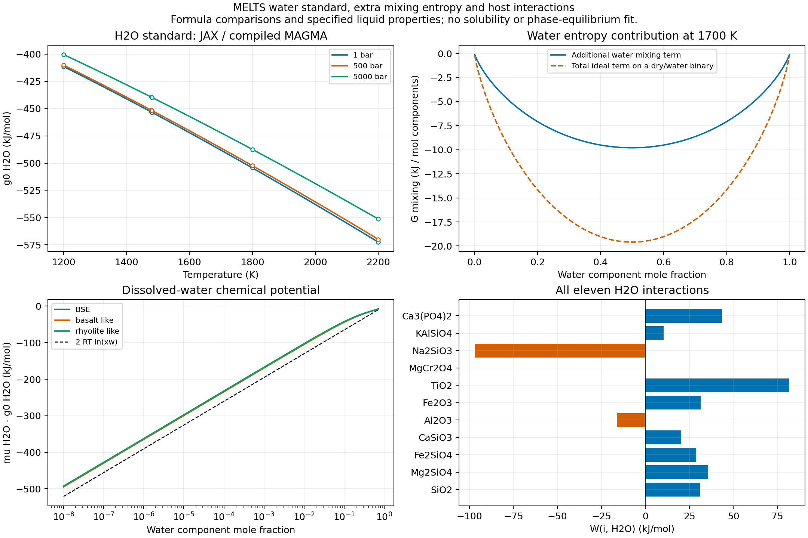
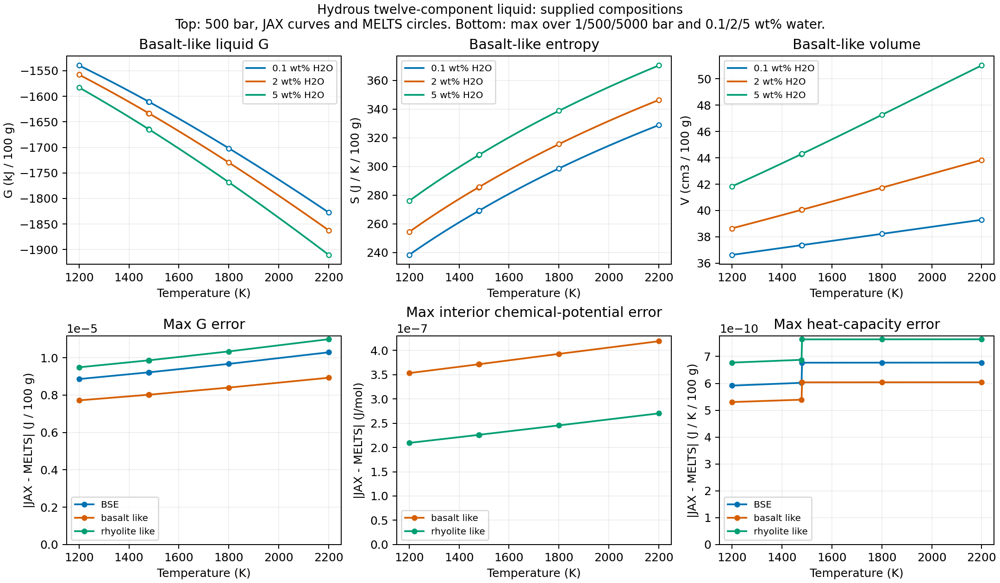

Native JAX hydrous silicate liquid
==================================

``exoeos.magma.liquid_gibbs`` now accepts ``HYDROUS_COMPONENTS``:
the :doc:`native_magma` dry eleven-component basis followed by H2O.
It evaluates a supplied liquid composition using the MELTS water standard,
all eleven water/host interactions, and the additional water mixing entropy.
The whole calculation and its derivatives run in JAX with x64; ordinary
evaluation and tests need no external MELTS installation.

This implements the MELTS water option. The existing empirical water
models in ``examples/m2_material`` remain separate alternatives; their
computational kernels are not migrated here. Adding such a solubility
correction to this G would count water thermodynamics twice. The current
extension supplies liquid properties, not water saturation, hydrous minerals,
redox equilibrium or crystallization. The separate :doc:`native_magma_fluid`
connects an explicit H2O gas standard to an existing EOS for supplied-state
chemical-potential comparisons.

API and conserved inventory
----------------------------

.. list-table:: Inputs and results
   :header-rows: 1
   :widths: 38 62

   * - Entry point
     - Contract
   * - ``HYDROUS_COMPONENTS``
     - SiO2, Mg2SiO4, Fe2SiO4, CaSiO3, Al2O3, Fe2O3, TiO2,
       MgCr2O4, Na2SiO3, KAlSiO4, Ca3(PO4)2, H2O; mol of these formulas
   * - ``liquid_gibbs(T, P, n)`` with shape (12,)
     - Scalar K, Pa, absolute mol amounts; returns extensive J
   * - ``liquid_standard_gibbs(T, P, include_h2o=True)``
     - Twelve standards in J/mol; implies ``include_dry11=True``
   * - ``HYDROUS_OXIDES``
     - ``DRY11_OXIDES + ("H2O",)``; mol, not oxide mass or weight percent
   * - ``liquid_moles_from_oxides`` / ``oxide_moles_from_liquid``
     - Accept shape (11,) or (12,); H2O passes through unchanged
   * - ``element_matrix(HYDROUS_COMPONENTS)``
     - Twelve rows in ``ELEMENTS`` order; the new final row is H

H2O contributes one O and two H atoms per formula mol. All older dry
columns gain a zero H entry. This changes the number of element rows
from 11 to 12; consumers must use ``len(ELEMENTS)``. The component orders,
defaults and energies of the existing dry APIs are retained. Both oxide
transforms preserve signed residuals: callers must validate nonnegative
oxide and component amounts, including the existing dry-host constraints.

.. code-block:: python

   import jax
   jax.config.update("jax_enable_x64", True)
   import jax.numpy as jnp
   from exoeos.magma import (
       HYDROUS_COMPONENTS, element_matrix, liquid_gibbs,
       liquid_moles_from_oxides,
   )

   # HYDROUS_OXIDES order; the last entry is 0.25 mol H2O.
   m = jnp.array([2., 1., .4, .5, .3, .1, .07, .02, .08, .04, .03, .25])
   n = liquid_moles_from_oxides(m)
   G = jax.jit(liquid_gibbs)(1700., 5e7, n)
   mu = jax.grad(liquid_gibbs, 2)(1700., 5e7, n)
   atoms = element_matrix(HYDROUS_COMPONENTS) @ n  # H = 0.5 mol atoms
   Cp = -1700. * jax.grad(jax.grad(liquid_gibbs, 0), 0)(1700., 5e7, n)

One extensive Gibbs energy
---------------------------

Let :math:`N=\sum_i n_i`, :math:`x_i=n_i/N`, and let :math:`w` denote
H2O. With :math:`R=8.3143` J/(mol K), the MELTS restriction is

.. math::

   G = \sum_i n_i g_i^0(T,P)
       + RTN\sum_i x_i\ln x_i
       + N\sum_{i<j}W_{ij}x_i x_j
       + RTN\left[x_w\ln x_w+(1-x_w)\ln(1-x_w)\right].

The third term contains 55 existing dry pairs and 11 water pairs. All
66 interactions have zero entropy and volume coefficients in this model.
The last term is **additional** to the ordinary component ideal entropy.
For a single dry component mixed with water, the ideal binary term is
therefore doubled. It contributes :math:`RT\ln x_w` to the water chemical
potential and :math:`RT\ln(1-x_w)` to every dry-component chemical potential.
In particular,

.. math::

   \mu_w = g_w^0 + 2RT\ln x_w
       + \sum_{j\ne w}W_{wj}x_j
       - \sum_{i<j}W_{ij}x_i x_j.

Composition derivatives are defined in the strictly positive interior.
Zero amounts use the continuous energy limit :math:`0\ln0=0`: the dry
face recovers the dry G and T/P derivatives, pure water recovers its
standard, and an absent phase has G=0. No concentration floor is used.
The dry-host fraction is evaluated as the sum of dry amounts divided by N,
which also avoids cancellation close to pure water. Absent components
have divergent ideal chemical potentials; an absent phase has no chemical
potentials. Pure-water energy is a formal component endpoint, not a
claim that a silicate-free liquid is stable.

.. csv-table:: Water interactions from the pinned MELTS header (J/mol)
   :file: _static/magma/hydrous_interactions.csv
   :header-rows: 1

H2O standard and pressure convention
-------------------------------------

The water standard uses the special MELTS branch of ``gibbs.c``, not the
fusion construction of the dry components. Define :math:`p=P/10^5` in
**absolute bar**. It is not :math:`p-1` in the following polynomial:

.. math::

   g_w^0(T,P) = g_{\rm Haar}(T,1\,{\rm bar})
       + RT\left[-\frac{33676}{T}+18.3527+\Phi(T,p)-q(T)\right],

.. math::

   \begin{aligned}
   \Phi(T,p)={}&(0.110/T+4.432\,10^{-5}+1.405\,10^{-7}T-2.394\,10^{-11}T^2)p\\
      &+(7.337\,10^{-8}/T-1.170\,10^{-8}-9.502\,10^{-13}T)p^2\\
      &+(1.876\,10^{-10}/T+4.586\,10^{-13})p^3-1.191\,10^{-14}p^4/T,\\
   q(T)={}&2.9147\ln T-9.6863\,10^{-4}T+6.8593\,10^{-8}T^2
      +77.8899/\sqrt T\\
      &-28954.8/T-2263.27/T^2-15.8997.
   \end{aligned}

The private ``_magma_water`` module retains the Haar base, ideal and all
40 residual terms from ``water.c``. Its specific Helmholtz energy A is
in bar cm3/g and density is in g/cm3. At 1 bar it solves
:math:`\rho^2 A_\rho=1` and returns

.. math::

   g_{\rm Haar}=1.80152(A+1/\rho)
       -285829.96-298.15\,(69.9146)+54955.23970014.

Eight Newton steps start at the ideal vapor density; JAX differentiates
the converged scalar root implicitly. The supported water calculation
requires **T >= 700 K**, where this 1 bar vapor reference has a well-behaved
root. Only static shapes are checked; domain validation belongs to the
caller. It is not a general low-temperature water/steam solver. The source
reference tests cover 700--2500 K; liquid comparisons cover 1200--2200 K
and 1, 500, 5000 bar. These are numerical verification ranges, not new
experimental calibration or stability bounds. The old SiO2 heat-capacity
branch at 1480 K remains part of the dry standards.

   The H2O standard matches directly compiled upstream points. Extra water
   entropy doubles the ideal term on a binary edge. The water chemical
   potential includes the host interactions as well as the dilute
   :math:`2RT\ln x_w` term. The bottom plots use 1700 K and 500 bar.

Independent verification and reproduction
------------------------------------------

The source fixture contains 27 H2O standard states from the actual compiled
``water.c`` and the extracted H2O branch of ``gibbs.c``. All five source
files are SHA-256 checked at MAGMA revision
``705a0fb315e5054d18275a580562f6121c8e458c``. It also parses every water pair
from ``param_struct_data_v34.h``; the JAX implementation is never imported
by the generator.

The separate runtime fixture uses hash-pinned alphaMELTS 2.3.2 /
rhyolite-MELTS 1.0.2, with supplied compositions and oxygen buffering
disabled. Its 148 states include 98 strictly interior chemical-potential
comparisons, wet BSE and two synthetic hosts at 0.1/2/5 wt% H2O, random
mixtures, a sevenfold amount scaling, dry/trace-water limits and binary
edges. Weight percent refers to the complete 100 g liquid. Every returned
oxide inventory, component fraction and Euler identity is checked.

.. list-table:: Maximum absolute differences over all 148 runtime states
   :header-rows: 1

   * - Quantity
     - Maximum difference
   * - G
     - 5.69e-5 J
   * - Interior chemical potentials
     - 2.85e-6 J/mol
   * - Standards present in the mixture
     - 9.32e-10 J/mol
   * - Entropy
     - 8.46e-9 J/K
   * - Heat capacity
     - 4.18e-9 J/K
   * - Volume
     - 1.51e-14 m3
   * - dV/dT
     - 4.86e-20 m3/K
   * - dV/dP
     - 9.70e-26 m3/Pa

Extensive errors use the supplied amounts, including the sevenfold sample;
they are not molar or experimental uncertainty estimates. The wider
compiled-source grid has maximum standard-G error 1.39e-8 J/mol.
Seven exact water/dry binary edges are unavailable because native oxide
conversion produces a negative residual SiO2. Pure water produces nonfinite
native mixing G/S. These eight failures are preserved without perturbing
inputs; all eleven pair coefficients and continuous endpoints are checked
separately. Hessian symmetry, Euler homogeneity, finite differences,
implicit-root residuals, JIT/vmap, atom-conserving transforms, and the
:math:`2RT\ln x_w` dilution slope are tested.

   Upper panels compare the basalt-like complete liquid at 500 bar.
   Lower panels show maxima over all sampled pressures and water contents
   for each host. BSE has exactly zero Fe2O3 and is excluded from the full
   interior composition-gradient comparison.

Reproduce both figures and the numerical summary without MELTS:

.. code-block:: bash

   JAX_PLATFORMS=cpu python examples/magma_hydrous.py --output /tmp/hydrous
   python -m pytest tests/unittests/magma_hydrous_test.py

Optional independent fixture regeneration (C compiler for source mode;
the separately installed pinned runtime and tinynumpy for runtime mode):

.. code-block:: bash

   python tests/reference/generate_hydrous_reference.py \
     --source /path/to/pinned/source/files --output /tmp/hydrous_source.json
   python tests/reference/generate_hydrous_reference.py \
     --runtime /path/to/alphamelts-py-2.3.2-ubuntu_22_04-x86_64 \
     --output /tmp/hydrous_melts.json

The source directory contains the basenames ``gibbs.c``, ``water.c``,
``liquid_v34.c``, ``liq_struct_data.h`` and ``param_struct_data_v34.h`` from
the `pinned MAGMA tree <https://github.com/magmasource/MAGMA/tree/705a0fb315e5054d18275a580562f6121c8e458c>`_.
Runtime installation and provenance follow :doc:`melts_silicate_reference`.
