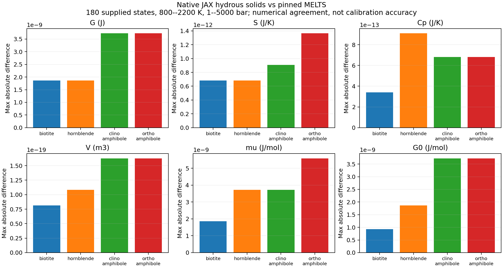
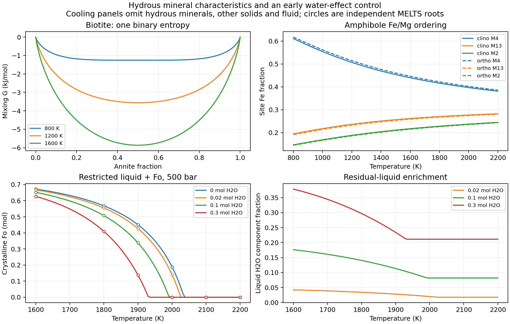

Native JAX hydrous minerals
===========================

``exoeos.magma_solids`` adds biotite, hornblende and Ca--Mg--Fe(II)
clino/orthoamphiboles. Each phase evaluates one extensive scalar G and
its JAX derivatives. All standards, coefficients and order solvers ship
in the installed package; evaluation needs neither ``examples/`` nor MELTS.
Enable x64. This transfers the pinned MELTS models without an empirical
water correction or a new experimental calibration.

Hydrous mineral inventory
-------------------------

.. list-table:: Implemented phases, characteristics and references
   :header-rows: 1
   :widths: 18 29 35 18

   * - Phase / module
     - Formula-mol basis
     - Characteristics and coverage
     - Numerical source / background
   * - Biotite / ``biotite``
     - Annite KFe3Si3AlO10(OH)2; phlogopite KMg3Si3AlO10(OH)2
     - Fe(II)--Mg binary; one ideal binary entropy and W=13430.64 J/mol.
       No internal order, Ti, Fe(III), F or Cl substitution.
     - Pinned ``biotite.c`` and ``sol_struct_data.h``; Berman data [B, M]
   * - Hornblende / ``hornblende``
     - Pargasite NaCa2Mg4Al3Si6O22(OH)2; ferropargasite
       NaCa2Fe4Al3Si6O22(OH)2; magnesiohastingsite NaCa2Mg4FeAl2Si6O22(OH)2
     - Independent Fe(II)/Mg and Fe(III)/Al substitutions, multiplicities
       4 and 1; signed pargasite is physical. Fixed Na/Ca/OH; no order solve.
     - Pinned ``hornblende.c``; header standards including Helgeson-derived
       pargasite and explicit Fe substitutions [M]
   * - Clinoamphibole / ``amphibole``
     - Cummingtonite Mg7Si8O22(OH)2; grunerite Fe7Si8O22(OH)2;
       tremolite Ca2Mg5Si8O22(OH)2
     - Ca--Mg--Fe(II) quadrilateral; two relaxed Fe/Mg site exchanges.
       M4, M13 and M2 multiplicities 2, 3, 2; signed cummingtonite is physical.
     - Pinned ``amphibole.c`` and header [M]; quadrilateral background [A]
   * - Orthoamphibole / ``amphibole``
     - Same three formal components
     - Separate orthorhombic mixing polynomial and endmember offsets;
       explicit structure choice. Same site and amount domain.
     - Pinned ``amphibole.c`` and header [M]; background [A]

All eight formulas contain two H atoms: one mol of a formula binds one
mol H2O. ``magma.element_matrix`` includes these exact formulas and keeps
the established ``ELEMENTS`` row order. They are fixed-OH models, not
continuous water-occupancy models. The phase list does not include
muscovite, chlorite or talc. The official MELTS site explicitly identifies
limitations in hornblende/biotite phase equilibria [L]; numerical agreement
below does not remove those physical limitations.

One scalar and its derivatives
------------------------------

With :math:`N=\sum_i n_i`, :math:`x_i=n_i/N`, :math:`p=P/10^5` in bar,
and :math:`R=8.3143` J/(mol K),

.. math::

   G(T,P,\boldsymbol n)=\sum_i n_i g_i^0(T,P)
      +N\min_{\boldsymbol q}\left[H(\boldsymbol x,\boldsymbol q)
      -TS(\boldsymbol x,\boldsymbol q)+(p-1)V(\boldsymbol x,\boldsymbol q)
      +RT\sum_s m_s y_s\ln y_s\right].

Only the two amphibole structures have independent order variables
:math:`\boldsymbol q`. The non-configurational H/S/V polynomials are
packaged in ``_hydrous_coefficients.py``; ``y_s`` are physical site fractions.
Standards use the existing Berman integral, with :math:`T_r=298.15` K:

.. math::

   C_P^0=k_0+k_1T^{-1/2}+k_2T^{-2}+k_3T^{-3},\qquad
   g^0=H_r+\int_{T_r}^T C_P^0\,dT
       -T\left[S_r+\int_{T_r}^T C_P^0/T\,dT\right]
       +\int_{1\,{\rm bar}}^p V^0(T,p')\,dp'.

The header's Berman volume polynomial and pressure integral are reused
without added runtime offsets. Both amphibole structures use the same
monoclinic standards. The orthorhombic H/S/V offsets remain in its mixing
polynomial, so an ortho pure endpoint need not equal ``standard_gibbs``.

Writing :math:`f(z)=z\ln z+(1-z)\ln(1-z)`, the simpler models are

.. math::

   g_{\rm mix}^{\rm Bio}=13430.64x_{\rm An}(1-x_{\rm An})+RTf(x_{\rm An}),

.. math::

   g_{\rm mix}^{\rm Hbl}=28116.48u(1-u)+16780v(1-v)
                         +RT[4f(u)+f(v)].

Here An denotes annite, :math:`u=x_{\rm ferropargasite}` and
:math:`v=x_{\rm magnesiohastingsite}`. The biotite entropy is deliberately
one binary term, as in the pinned code, despite three octahedral cations.

For amphibole, Fe site fractions :math:`a,b,c` on M4/M13/M2 obey
:math:`2a+3b+2c=7x_{\rm Grn}`; :math:`d=x_{\rm Tr}` occupies M4 Ca.
The seven entropy occupations are :math:`a,1-a-d,d,b,1-b,c,1-c`, with
multiplicities :math:`2,2,2,3,3,2,2`. Fe/Mg exchange is minimized at fixed
bulk composition with the shared feasible Newton solver. Minority-cation
coordinates and separately retained Fe/Mg occupations avoid loss of trace
Mg near grunerite. Implicit AD uses the stationary equation, including
the relaxed Hessian correction on a stable smooth branch:

.. math::

   \overline G_{ab}=G_{ab}-G_{a q}G_{qq}^{-1}G_{q b},\quad
   \mu_i=\overline G_{n_i},\quad S=-\overline G_T,\quad
   C_P=-T\overline G_{TT},\quad V=\overline G_P.

No automatic structural transition or global phase selection is performed.
Failed stationarity/positive-curvature checks return NaN. Tests verify
Euler's identity :math:`G=\boldsymbol n\cdot\boldsymbol\mu`, amount scaling,
Hessian symmetry, :math:`G_{nn}\boldsymbol n=0`, finite differences and
mixed T/P/amount derivatives with pressure coordinates scaled for accuracy.

API and distinct boundaries
---------------------------

Each module exports ``COMPONENTS``, ``standard_gibbs(T,P)`` (J/mol),
``mixing_gibbs(T,P,n)`` and ``gibbs(T,P,n)`` (J). T and P are scalar K and
Pa; n contains absolute formula amounts in mol. Amphibole additionally
exports ``order`` and accepts ``phase='clinoamphibole'`` or
``phase='orthoamphibole'`` on its mixture/order functions.

.. code-block:: python

   import jax
   jax.config.update("jax_enable_x64", True)
   import jax.numpy as jnp
   from exoeos.magma_solids import amphibole

   n = jnp.array([0.4, 0.3, 0.3])  # Cum, Grn, Tr; one formula mol
   G = jax.jit(amphibole.gibbs)(1200., 5e7, n)
   mu = jax.grad(amphibole.gibbs, 2)(1200., 5e7, n)
   Cp = -1200.*jax.grad(jax.grad(amphibole.gibbs))(1200., 5e7, n)

The caller validates finite positive T/P and the physical site domain.
Biotite requires nonnegative formula amounts. For N>0, hornblende requires
:math:`0\le x_1,x_2\le1`, allowing :math:`x_0=1-x_1-x_2<0`.
Amphibole requires :math:`0\le x_{\rm Tr}\le1` and
:math:`0\le7x_{\rm Grn}\le7-2x_{\rm Tr}`. For example, ferroactinolite's
formal endmember uses ``[-5/7,5/7,1]``. Do not clip signed components.

.. list-table:: Boundary contracts
   :header-rows: 1

   * - Boundary
     - Meaning
   * - Whole phase absent
     - Exactly G=0 and zero T/P derivatives. The AD sentinel at all-zero n
       is not a chemical potential; evaluate a present candidate phase.
   * - Composition/site endpoint
     - Continuous G with 0 log 0=0 and fixed-face T/P derivatives. Inserting
       an absent species can have divergent mu; endpoint composition AD is
       excluded. Positive approaches are tested down to 1e-12 mol.
   * - Temperature branch
     - These mineral standards add no temperature cutoff. The connected
       liquid retains its 1480 K SiO2 branch; do not differentiate across it.
   * - Internal order / structure
     - AD applies within a converged stable order branch. A loss of curvature,
       branch switch, or crossing of clino/ortho G is a separate boundary.

Independent comparisons and water-effect control
------------------------------------------------

The saved hash-pinned alphaMELTS 2.3.2 / rhyolite-MELTS 1.0.2 reference
has 180 interior states: four phases, three compositions (including signed
coordinates), five temperatures from 800 to 2200 K and three pressures
(1, 500, 5000 bar). All G, mu, standards, S, Cp and V come from native
calls; the generator imports no JAX thermodynamic implementation. Native
oxide ledgers, fractions and Euler identities are checked.

One reference pitfall is recorded explicitly: ``conHrn``'s oxide projection
changes supplied hornblende fractions (its pargasite coordinate is set to
Mg, and it imposes Fe valence floors). G/S/Cp/V therefore use direct native
molar input; mu uses the native ``actHrn`` function at the requested site
fractions plus native standards. The changed oxide-projection fractions
are retained as diagnostics, never substituted for the requested state.

There are 33 pure-endpoint diagnostic records; 27 contain nonfinite native
G/S or Cp. Finite reference quantities are checked. Independently, every
JAX pure endpoint has finite continuous G and fixed-face S/Cp/V, checked
by finite differences. Numerical verification bounds are not calibration
or mineral-stability bounds.

.. list-table:: Maximum absolute differences, 180 interior states
   :header-rows: 1

   * - G / standards
     - mu
     - S
     - Cp
     - V
   * - 3.73e-9 J / J mol-1
     - 5.59e-9 J/mol
     - 1.37e-12 J/K
     - 9.10e-13 J/K
     - 1.63e-19 m3

   Numerical transfer accuracy; these are sampled maxima, not experimental errors.

Water-induced crystallization changes can already be tested using the
existing hydrous liquid. The example holds a synthetic Mg-rich dry host
fixed and adds 0, 0.02, 0.1 or 0.3 mol H2O at 500 bar, restricting solids
to pure forsterite:

.. math::

   G_{\rm total}(\xi)=G_\ell(T,P,\boldsymbol n_0-\xi\boldsymbol e_F)
      +\xi g_F^0(T,P),\qquad
   G_{\rm total}'=g_F^0-\mu_F^\ell,\quad 0\le\xi\le0.75.

The dry host in ``DRY11_COMPONENTS`` order is
``[.25,.75,.02,.05,.02,.005,.005,.002,.01,.005,.002]`` mol.
Its components are all positive; the water-free case uses the dry API.
The test verifies positive curvature on these sampled paths, atom
conservation and the interior root/complementarity conditions. At 1900 K,
Fo amounts are respectively 0.450725, 0.426993, 0.337887 and 0.137842 mol.
The 24 independent native roots agree within 1.50e-11 mol, with total-G
differences below 1.59e-5 J. This control suppresses hydrous minerals,
other solids and fluid; it is not a complete hydrous crystallization sequence.
Separate transfer tests consume one mol H2O per formula mol of each new
mineral and check the atom ledger and derivative of the combined G.

   Top: mineral properties at 500 bar (amphibole Cum/Grn/Tr=0.4/0.3/0.3).
   Bottom: restricted liquid+Fo cooling; circles are independent native roots.

Reproduce without MELTS:

.. code-block:: bash

   JAX_PLATFORMS=cpu python examples/magma_hydrous_solids.py --output /tmp/hydrous-solids
   python -m pytest tests/unittests/magma_hydrous_solids_test.py

Optional reference regeneration requires the separately installed pinned
runtime, its ``tinynumpy`` wrapper dependency, and SciPy for native cooling
roots. ``generate_hydrous_solid_reference.py --runtime PATH --output FILE``
hash-checks the runtime. ``extract_hydrous_solid_coefficients.py`` reproduces
the packaged site table; source hashes and interpretation are saved in
``tests/reference/hydrous_solids_source_v1.json``.

References
----------

* [M] `MAGMA 705a0fb
  <https://github.com/magmasource/MAGMA/tree/705a0fb315e5054d18275a580562f6121c8e458c>`_:
  ``sources/{biotite,hornblende,amphibole,gibbs}.c`` and
  ``includes/sol_struct_data.h``. Exact numerical authority for this transfer.
* [B] `Berman (1988), Internally-consistent thermodynamic data for minerals
  <https://doi.org/10.1093/petrology/29.2.445>`_: standard-state formalism;
  the pinned header includes subsequent endmember-specific updates.
* [A] `Ghiorso & Evans (2002), Thermodynamics of the amphiboles:
  Ca--Mg--Fe2+ quadrilateral <https://doi.org/10.2138/am-2002-0109>`_:
  related model background. The older source's coefficient identity with
  every coefficient in this publication is not asserted.
* [L] `Official MELTS model limitations <https://melts.ofm-research.org/>`_:
  hornblende/biotite phase equilibria require particular care.
* `alphaMELTS 2.3.2 <https://github.com/magmasource/alphaMELTS/releases/tag/v2.3.2>`_:
  separately hash-pinned independent runtime reference.
