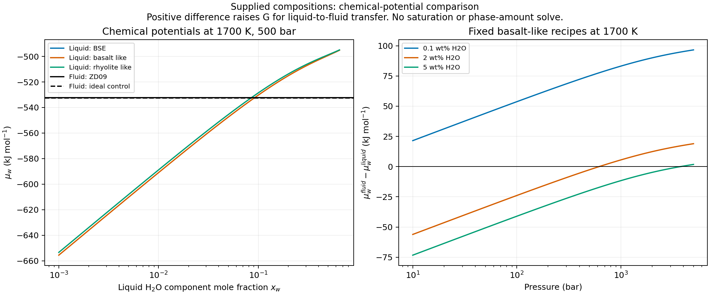
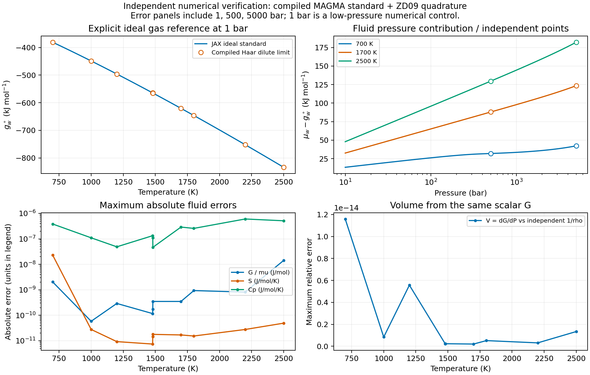

Native JAX H2O fluid connection
===============================

``exoeos.magma_fluid`` supplies pure H2O fluid Gibbs energy for comparison
with the :doc:`native_hydrous_liquid`. An explicit ideal-gas standard on
the MELTS Haar reference convention is combined with an existing residual
EOS. All kernels and coefficients are installed with ExoEOS; evaluation
requires neither ``examples/`` nor external MELTS.

This is a **hybrid property model**: the reference is inherited from Haar,
and the pressure dependence comes from the selected EOS. In particular,
Zhang--Duan plus this standard is not the MELTS fluid implementation.
The caller supplies T, P and liquid composition. Saturation curves,
fluid amounts, phase selection and their validation belong to ExoGibbs.
No empirical water-solubility correction is added to the MELTS liquid G.

API and example
----------------

.. list-table:: Installed submodule API
   :header-rows: 1

   * - Function
     - Input and result
   * - ``water_gas_standard_gibbs(T)``
     - Scalar K; ideal H2O gas standard at 1 bar, J/mol
   * - ``water_fluid_gibbs(T, P, n, eos=...)``
     - Scalar K, Pa and mol H2O; extensive G in J

The EOS is required explicitly and must represent pure H2O. The existing
``ZhangDuanEOS.from_species(("H2O",))`` is the example model;
``IdealEOS()`` is a useful control. The common EOS entry point uses
``x=[1]`` and ``phase="vapor"``. This selector can denote a dense
supercritical state; it does not establish global phase stability.
Shapes are checked, while finite values, nonnegative amounts, species
identity and model domains are caller contracts. Enable x64.

.. code-block:: python

   from functools import partial
   import jax
   jax.config.update("jax_enable_x64", True)
   import jax.numpy as jnp
   from exoeos import ZhangDuanEOS
   from exoeos.magma import liquid_gibbs
   from exoeos.magma_fluid import water_fluid_gibbs

   eos = ZhangDuanEOS.from_species(("H2O",))
   fluid = partial(water_fluid_gibbs, eos=eos)
   T, P = 1700., 5e7
   dry = jnp.linspace(.02, .2, 11)  # DRY11_COMPONENTS order, mol
   nw = .25                       # dissolved H2O, mol
   mu_liquid = jax.grad(
       lambda w: liquid_gibbs(T, P, jnp.r_[dry, w])
   )(nw)
   mu_fluid = jax.jit(jax.grad(fluid, 2))(T, P, 1.)
   delta_mu = mu_fluid - mu_liquid  # J/mol; candidate transfer cost
   S = -jax.grad(fluid, 0)(T, P, .1)  # J/K for 0.1 mol
   Cp = -T * jax.grad(jax.grad(fluid, 0), 0)(T, P, .1)
   V = jax.grad(fluid, 1)(T, P, .1)    # m3

For a fixed dry inventory and water transfer :math:`\xi` from liquid to
fluid, the common scalar is

.. math::

   G_{\rm total}(\xi)
     = G_\ell(T,P,\mathbf n_{\rm dry},n_w-\xi)
       +G_f(T,P,n_f+\xi),\qquad
   \frac{\partial G_{\rm total}}{\partial\xi}
     =\mu_w^f-\mu_w^\ell.

Both components represent one mol H2O (two H atoms and one O atom), so
this transfer preserves the element inventory. A positive difference
means a positive infinitesimal liquid-to-fluid transfer raises G at the
supplied state. Equality alone does not establish a stable multiphase
equilibrium or determine the amount of fluid.

   Left: three dry host ratios at 1700 K and 500 bar; the derivative holds
   dry amounts fixed at each plotted composition. Right: fixed basalt-like
   recipes with 0.1, 2 and 5 wt% H2O in the complete liquid mass. The fluid
   is pure H2O. Crossings are visual comparisons, not solved saturation
   curves. The two fluid controls nearly overlap at 500 bar, differing by
   about 0.111 kJ/mol.

.. list-table:: Supplied basalt-like states at 1700 K (kJ/mol H2O)
   :header-rows: 1

   * - Pressure (bar)
     - H2O (wt%)
     - Liquid mu
     - Fluid mu
     - Fluid minus liquid
   * - 50
     - 2
     - -531.503820
     - -565.024219
     - -33.520398
   * - 500
     - 2
     - -529.776665
     - -532.376863
     - -2.600198
   * - 5000
     - 2
     - -515.751401
     - -496.793977
     - 18.957424
   * - 500
     - 0.1
     - -607.379709
     - -532.376863
     - 75.002846
   * - 500
     - 5
     - -512.622751
     - -532.376863
     - -19.754112

Explicit standard and one scalar G
----------------------------------

Let :math:`P^\circ=10^5` Pa and let :math:`\phi` be the pure-water
fugacity coefficient from the selected EOS. Its residual Helmholtz model
supplies :math:`\ln\phi=\alpha^r+Z-1-\ln Z`. The fluid energy is

.. math::

   G_f(T,P,n_f)=n_f\left[g_w^\circ(T)
       +R_{\rm EOS}T\left(\ln\frac{P}{P^\circ}+\ln\phi(T,P)\right)\right].

The standard is the analytic zero-density limit of the pinned MAGMA
``water.c`` on the same energy reference convention as the liquid:

.. math::

   g_w^\circ(T)=C+R_H T\left[1-I(T)-\ln(1.01325)\right],

.. math::

   \begin{aligned}
   I(T)&=1+\left(\frac{19.730271018}{t}+20.9662681977\right)\ln t
               +\sum_{k=-3}^{12}c_k t^k,\qquad t=\frac{T}{100\,{\rm K}},\\
   R_H&=1.80152\,(4.6152)=8.314375104\ {\rm J\,mol^{-1}\,K^{-1}},\\
   C&=-285829.96-298.15\,(69.9146)+54955.23970014\ {\rm J\,mol^{-1}}.
   \end{aligned}

The sixteen :math:`c_k` are shared with the liquid's Haar kernel in
``_magma_water._haar_ideal`` (``ci[3:19]`` in the upstream C source).
The logarithm converts the source's 1 atm normalization to the explicit
1 bar ideal standard. The constant C is the original reference shift,
including the fixed 298.15 K factor. A real Haar vapor at 1 bar still has
a residual contribution and must not be substituted for this ideal standard.

The existing EOS uses :math:`R_{\rm EOS}=8.31446261815324`
J/(mol K). The inherited liquid mixing terms use 8.3143 J/(mol K),
and the Haar reference uses :math:`R_H` above. Each original coefficient
is retained inside its own scalar; no constant is silently replaced.
The comparison is made in dimensional J/mol on the shared reference
convention. It is an explicit hybrid model, not exact reproduction of
Haar's finite-pressure EOS or Zhang--Duan's own statistical-mechanical
gas standard.

For :math:`n_f>0`, all observables derive from this same G:

.. math::

   \mu_w^f=G_{f,n_f},\qquad S_f=-G_{f,T},\qquad
   C_{P,f}=-T G_{f,TT},\qquad V_f=G_{f,P}=\frac{n_f}{\rho_{\rm EOS}}.

In a smooth branch :math:`G_{f,TP}=G_{f,PT}`, with
:math:`\partial S_f/\partial P=-\partial V_f/\partial T`.
Extensivity gives :math:`G_f=n_f\mu_w^f`,
:math:`G_f(\lambda n_f)=\lambda G_f(n_f)` and :math:`G_{f,n_fn_f}=0`.
The temperature-dependent standard stays inside the differentiated graph.

Boundaries and derivative scope
--------------------------------

.. list-table:: Distinct limits
   :header-rows: 1

   * - Case
     - Contract
   * - Entire fluid phase absent
     - G=0 at n=0. The guarded AD value there is not a chemical potential.
       Evaluate the candidate fluid at a positive amount, such as 1 mol.
   * - Liquid composition endpoints
     - The existing continuous dry-face and pure-water energies apply.
       The dilute water potential diverges; never differentiate an absent
       component and reinterpret a guarded value as its potential.
   * - Temperature branches
     - The gas standard is smooth on T >= 700 K. The liquid retains its
       SiO2 branch at 1480 K; compare derivatives within each branch.
   * - Internal ordering branches
     - No new order parameter is introduced. Existing mineral order
       transitions keep their phase-specific derivative restrictions.
   * - EOS density roots
     - Derivatives require a smooth, mechanically stable selected root.
       Root changes and spinodal singularities are not covered by local AD.

Numerical checks cover 700--2500 K and 1, 500, 5000 bar; the chemical
potential plot uses 1700 K and 10--5000 bar. The 1 bar fluid states are
low-pressure numerical controls outside the main Zhang--Duan mixture
calibration range. These checks do not extend the empirical EOS range,
establish a common experimental liquid/fluid validity domain, or validate
low-temperature water condensation.

Independent verification
------------------------

``tests/reference/magma_fluid_v1.json`` stores ten standards from the
**unmodified, SHA-256-checked compiled** ``water.c`` at MAGMA revision
``705a0fb315e5054d18275a580562f6121c8e458c``. The generator removes
:math:`R_HT\ln(P/P^\circ)` at 0.001 and 0.0005 bar and extrapolates
linearly to zero pressure. Entropy is corrected consistently and Cp
requires no ideal pressure correction.

For 30 fluid states, an independent NumPy/SciPy implementation solves
the Zhang--Duan pressure equation and integrates
:math:`\alpha^r=\int_0^\rho [Z(T,r)-1]\,\mathrm{d}r/r`. Five-point differences
give thermal residual and volume derivatives (0.5 K and 0.0001 P steps).
The generator imports neither JAX nor ExoEOS. The existing 98 interior
hydrous-liquid states independently compare the water potential against
the pinned alphaMELTS 2.3.2 / rhyolite-MELTS 1.0.2 fixture.

.. list-table:: Maximum absolute numerical differences
   :header-rows: 1

   * - Quantity
     - Difference
   * - Ideal standard G
     - 1.43e-8 J/mol
   * - Fluid G / mu
     - 1.43e-8 J/mol
   * - Fluid entropy
     - 2.31e-8 J/(mol K)
   * - Fluid Cp
     - 6.03e-7 J/(mol K)
   * - Fluid molar volume
     - 5.56e-16 m3/mol
   * - Fluid dV/dT
     - 6.47e-15 m3/(mol K)
   * - Fluid dV/dP
     - 2.81e-18 m3/(mol Pa)
   * - Liquid water mu vs pinned MELTS
     - 2.46e-7 J/mol

These differences include reference finite-difference error; they are
not experimental uncertainties. Tests also cover ideal and Peng--Robinson
controls, G-derived EOS volume, mixed Hessian symmetry and finite
differences, Euler homogeneity, JIT/vmap, zero energy, atom-conserving
water transfer and both sides of the liquid's 1480 K branch.

   All plotted fluid properties come from the extensive scalar G.
   Independent references test both the standard and pressure contribution.

.. code-block:: bash

   JAX_PLATFORMS=cpu python examples/magma_fluid.py --output /tmp/fluid
   python -m pytest tests/unittests/magma_fluid_test.py
   # Optional reference regeneration: C compiler and SciPy, no MELTS runtime.
   python tests/reference/generate_magma_fluid_reference.py \
     --water-source /path/to/pinned/water.c --output /tmp/magma_fluid.json

Sources: `pinned MAGMA water.c <https://github.com/magmasource/MAGMA/blob/705a0fb315e5054d18275a580562f6121c8e458c/sources/water.c>`_
and `Zhang and Duan (2009), Eq. 8 and Tables 3--4 <https://doi.org/10.1016/j.gca.2009.01.021>`_.
Machine-readable numerical results are in
:download:`fluid_comparison.json <_static/magma/fluid_comparison.json>`.
