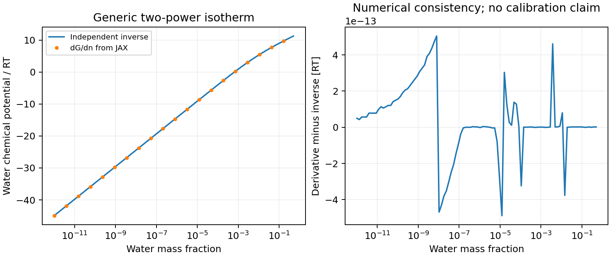

# Two-power scalar verification

This is a numerical consistency check, not a solubility calibration.
The supplied illustrative coefficients are C=(0.00005, 0.0006), a=(0.8, 0.45),
with dry water-equivalent amount S=1 mol. The gas standard is omitted.
`derivative.csv` compares the scalar's JAX water derivative with an independent
SciPy monotone inverse over water mass fractions 1e-12 through 0.5.

Reproduce with `JAX_ENABLE_X64=1 python examples/m2_material/two_power_water.py
--output results/sun_yao_water`. The tests additionally compare the full scalar
with independent quadrature, verify curvature, dry-host derivatives, scaling,
T/P derivatives, gas-reference shifts, and unchanged H2/He contributions.

Sun–Yao fitted coefficients remain in ExoGibbs. The concrete ExoInventory
consumer evaluates those coefficients inside the differentiated scalar.
A thermodynamic continuation that reproduces a solubility law is not evidence
of experimental validity in a new mixture.
